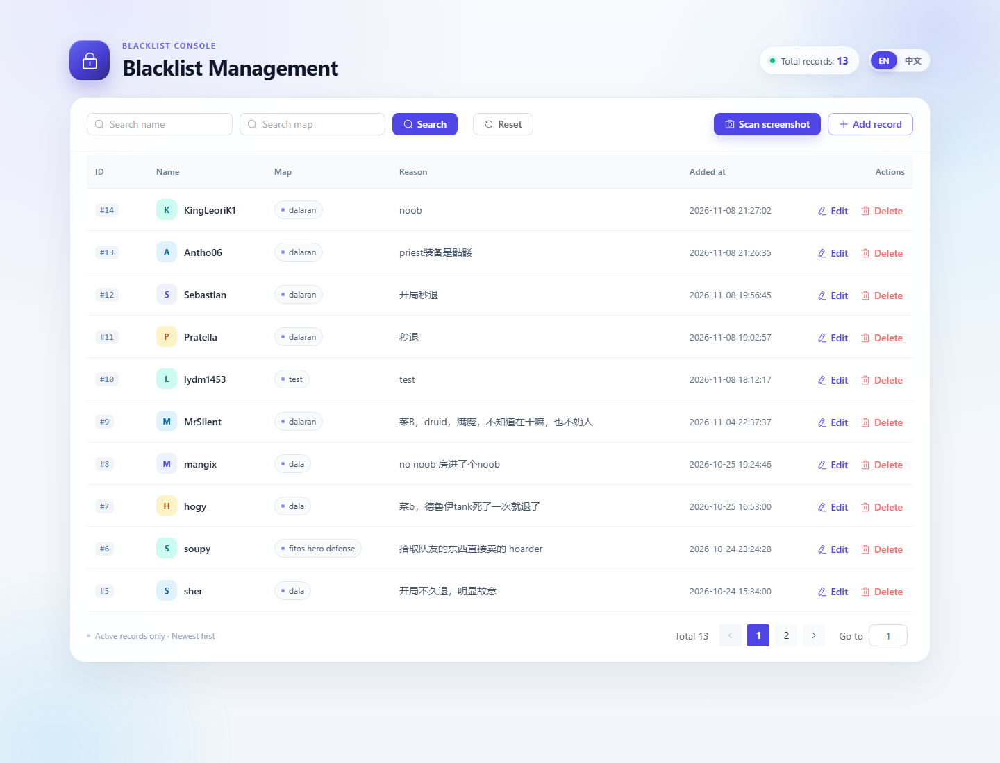
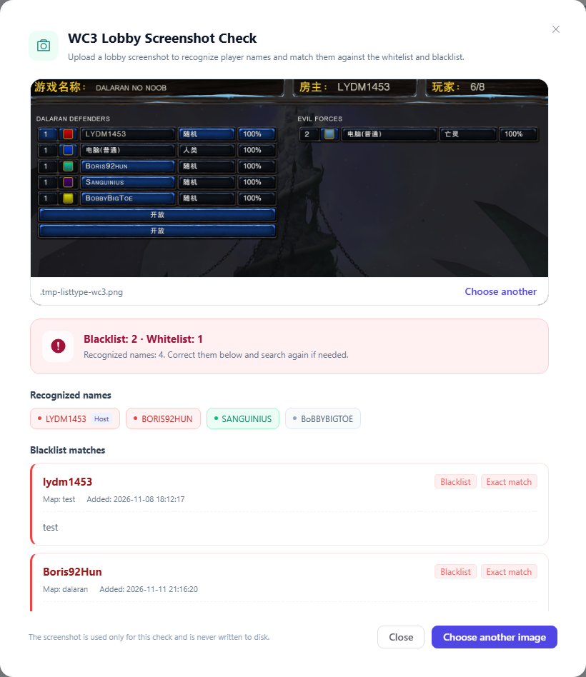
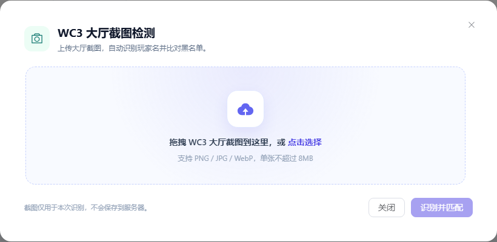

# Blacklist Management System

English | [简体中文](README.md)

A blacklist management application built with **Vue 3 + Element Plus + Axios + Koa 2**. Data is persisted in a local JSON file, with full support for search, pagination, create, update, and soft delete. It also includes **WC3 lobby screenshot scanning**: upload a lobby screenshot and the app recognizes player names and checks them against the blacklist.



## Features

- Shows only records where `isDeleted !== true`, sorted by `addTime` descending
- Fixed page size of 10 records with pagination
- Fuzzy search by `name` or `map` using OR logic, case-insensitive
- 300 ms search debounce; empty filters return all records
- Create / edit dialogs with client-side and server-side validation
- Confirmation before deletion; records are soft-deleted and kept in the JSON file
- Unified request loading state and success / error toast notifications
- Auto-incrementing string IDs that are never reused after deletion
- Server-generated `addTime`
- `async-lock`-serialized reads and writes to prevent lost updates
- Automatically creates `data/blacklist.json` on first startup
- **WC3 lobby screenshot OCR**: locates both teams, recognizes player names, and returns blacklist matches with reasons
- OCR results can be corrected manually and matched again; screenshots are processed in memory only
- Frontend styles use **SCSS**, with separate components for forms and screenshot scanning
- Built-in **English / Chinese** internationalization, defaulting to English with a language switch in the top-right corner

## Tech Stack

| Layer | Technologies |
| --- | --- |
| Frontend | Vue 3, Vite 5, Element Plus, Axios, SCSS, Vue I18n |
| Backend | Koa 2, @koa/router, @koa/cors, koa-bodyparser, async-lock |
| Screenshot OCR | Tesseract.js 5, Sharp, bundled English trained data |
| Persistence | Local JSON file: `data/blacklist.json` |

## Internationalization

The app defaults to English on first visit. Use the `EN` / `中文` switch in the top-right corner to change languages.

- Translations are managed with `vue-i18n` and stored in `src/i18n/locales/`
- Element Plus component locale changes together with the page language
- The `<html lang>` attribute and browser tab title are updated automatically
- The selected language is saved under the `blacklist-locale` key in `localStorage`
- To reset back to the default English, run the following in the browser console:

  ```js
  localStorage.removeItem('blacklist-locale')
  location.reload()
  ```

## Frontend Components

| Component | Responsibility |
| --- | --- |
| `views/BlacklistView.vue` | List, search, pagination, deletion, and page layout |
| `components/BlacklistFormDialog.vue` | Create / edit dialog, form validation, and submission |
| `components/Wc3ScanDialog.vue` | Screenshot upload, OCR, match display, and manual name correction |

## Project Structure

```text
blacklist/
├─ data/
│  └─ blacklist.json          # Data file (created automatically on first run)
├─ server/
│  ├─ app.js                  # Koa instance, middleware, unified error responses
│  ├─ index.js                # Server entry point
│  ├─ blacklistStore.js       # JSON persistence, incrementing IDs, soft delete
│  ├─ routes/
│  │  └─ blacklist.js         # RESTful routes + screenshot scanning endpoints
│  ├─ services/
│  │  ├─ wc3Scan.js           # Color-block detection, image preprocessing, OCR, name cleanup
│  │  └─ blacklistMatcher.js  # Name normalization, exact and fuzzy matching
│  └─ utils/
│     ├─ errors.js            # HttpError
│     └─ validation.js        # Request validation
├─ src/
│  ├─ api/
│  │  ├─ request.js           # Axios wrapper and response interceptor with i18n errors
│  │  └─ blacklist.js         # Blacklist API functions
│  ├─ components/
│  │  ├─ BlacklistFormDialog.vue  # Create / edit dialog
│  │  └─ Wc3ScanDialog.vue        # WC3 screenshot scanning dialog
│  ├─ i18n/
│  │  ├─ index.js             # i18n initialization, switching, and persistence
│  │  └─ locales/
│  │     ├─ en-US.js          # English messages (default)
│  │     └─ zh-CN.js          # Chinese messages
│  ├─ styles/
│  │  ├─ index.scss           # Global SCSS
│  │  └─ _dialogs.scss        # Shared dialog heading mixin
│  ├─ views/BlacklistView.vue # Main list page
│  ├─ App.vue
│  └─ main.js
├─ docs/
│  ├─ preview.png
│  ├─ i18n-preview.png
│  ├─ scan-preview.png
│  └─ scan-upload.png
├─ index.html
├─ vite.config.js
├─ package.json
└─ .npmrc
```

## Getting Started

Requirements: Node.js >= 18.17, pnpm 9 recommended.

```bash
# Install dependencies
pnpm install

# Start both the Koa API (port 3000) and the Vite frontend (port 5173)
pnpm dev
```

> Server auto-restart is disabled by default to avoid the Windows / Node 20.9 `node --watch` FSWatcher crash. After changing backend code, restart `pnpm dev` manually.

- Frontend: <http://127.0.0.1:5173>
- API: <http://127.0.0.1:3000/api/blacklist>
- Data file: `data/blacklist.json`

Production build and local preview:

```bash
# Terminal 1: start the API
pnpm start

# Terminal 2: build and preview the frontend on port 4173
pnpm build
pnpm preview
```

> `.npmrc` uses the npmmirror registry and `node-linker=hoisted`. Adjust these settings if you use a different registry.
>
> OCR trained data is bundled with `@tesseract.js-data/eng`, so no network access is required at runtime.

### Optional Environment Variables

| Variable | Default | Description |
| --- | --- | --- |
| `PORT` | `3000` | Koa server port |
| `VITE_API_BASE_URL` | `/api` | Axios base URL for the frontend |

## WC3 Lobby Screenshot Scanning

Click **Scan screenshot** in the toolbar, then upload a WC3 lobby screenshot. The app recognizes player names and checks them against the blacklist.



Processing flow:

1. Sharp normalizes the image format and size, then uses player color blocks to locate each player row.
2. Each player-name region is enlarged, inverted, contrast-enhanced, and sharpened.
3. Tesseract.js performs OCR locally and automatically ignores computer players and UI text.
4. Names are matched exactly first, then with punctuation / whitespace ignored, and finally with length-limited fuzzy matching.
5. Results show recognized players, match reasons, maps, and record timestamps.
6. If OCR made a mistake, correct the names line by line in the dialog and click **Search again**.

Limitations:

- Supports PNG / JPG / WebP up to 8 MB
- The first OCR request needs to initialize the engine, usually taking 2–5 seconds
- Screenshots are processed in server memory and are never written to disk
- OCR and fuzzy matching are not 100% accurate; confirm results manually before taking action
- Only English OCR data is bundled. Chinese, Korean, or symbol-only names may not be recognized correctly; add or correct them manually when needed

Upload screen:



## Data Fields

| Field | Type | Required | Generated by | Constraints |
| --- | --- | --- | --- | --- |
| `id` | string | Yes | Backend | Numeric string: max ID across all records (including soft-deleted) + 1 |
| `name` | string | Yes | Frontend | 1–50 characters after trimming |
| `map` | string | Yes | Frontend | 1–50 characters after trimming; entered manually |
| `reason` | string | Yes | Frontend | 1–200 characters after trimming |
| `addTime` | string | Yes | Backend | `YYYY-MM-DD HH:mm:ss` |
| `isDeleted` | boolean | Yes | Backend | Defaults to `false`; `true` means soft-deleted |

Auto-incrementing string ID example:

```json
[
  { "id": "1", "name": "Alice", "isDeleted": true },
  { "id": "2", "name": "Bob", "isDeleted": false }
]
```

The next record receives `id: "3"`. Even though `id: "1"` was soft-deleted, it is never reused.

## API

All endpoints return the same response shape:

```json
{
  "code": 0,
  "data": {},
  "msg": "success"
}
```

On failure, `code` is the corresponding HTTP status code (400 / 404 / 413 / 422 / 500), `data` is `null`, and `msg` describes the error.

| Method | Path | Description |
| --- | --- | --- |
| GET | `/api/blacklist?name=&map=&page=1&pageSize=10` | Fuzzy search + pagination, automatically filters deleted records |
| POST | `/api/blacklist` | Create a record; body: `{ name, map, reason }` |
| PUT | `/api/blacklist/:id` | Update an active record; body: `{ name, map, reason }` |
| DELETE | `/api/blacklist/:id` | Soft-delete by setting `isDeleted` to `true` |
| POST | `/api/blacklist/scan` | Upload a WC3 screenshot for OCR matching; body: `{ image: "data:image/png;base64,..." }` |
| POST | `/api/blacklist/match` | Match corrected names again; body: `{ names: ["SANGUINIUS"] }` |

### Screenshot Scanning Response

```json
{
  "code": 0,
  "data": {
    "names": [
      { "name": "LYDM1453", "confidence": 21, "source": "host" },
      { "name": "SANGUINIUS", "confidence": 39, "source": "player" }
    ],
    "matches": [
      {
        "detectedName": "SANGUINIUS",
        "recognizedText": "SANGUINIUS",
        "matchType": "exact",
        "similarity": 1,
        "blacklist": {
          "id": "9",
          "name": "Sanguinius",
          "map": "dalaran",
          "reason": "AFK during the game",
          "addTime": "2026-11-04 22:37:37"
        }
      }
    ],
    "summary": {
      "recognizedCount": 2,
      "matchedCount": 1
    }
  },
  "msg": "success"
}
```

Possible `matchType` values:

- `exact`: identical after case normalization
- `normalized`: identical after ignoring spaces and punctuation, e.g. `solt.....` and `solt`
- `fuzzy`: fuzzy match for OCR mistakes; manual review recommended

### Query Response

```json
{
  "code": 0,
  "data": {
    "list": [
      {
        "id": "2",
        "name": "Bob",
        "map": "dalaran",
        "reason": "Left the game early.",
        "addTime": "2026-10-24 15:12:41",
        "isDeleted": false
      }
    ],
    "total": 1,
    "page": 1,
    "pageSize": 10
  },
  "msg": "success"
}
```

### curl Examples

```bash
# Create
curl -X POST http://127.0.0.1:3000/api/blacklist \
  -H "Content-Type: application/json" \
  -d "{\"name\":\"Alice\",\"map\":\"dalaran\",\"reason\":\"AFK\"}"

# Search + pagination
curl "http://127.0.0.1:3000/api/blacklist?name=ali&page=1&pageSize=10"

# Update
curl -X PUT http://127.0.0.1:3000/api/blacklist/1 \
  -H "Content-Type: application/json" \
  -d "{\"name\":\"Alice\",\"map\":\"dalaran\",\"reason\":\"Verified violation\"}"

# Soft delete
curl -X DELETE http://127.0.0.1:3000/api/blacklist/1
```

## Soft Delete and Validation

- Deletion only sets `isDeleted` to `true`; records are never physically removed
- List queries, updates, and subsequent deletes all filter out deleted records
- Repeated deletion, updating a deleted record, or using a missing ID returns `404`
- Missing required fields, length violations, and invalid pagination parameters return `400`
- Creating a new record after deletion continues from the highest historical numeric ID
