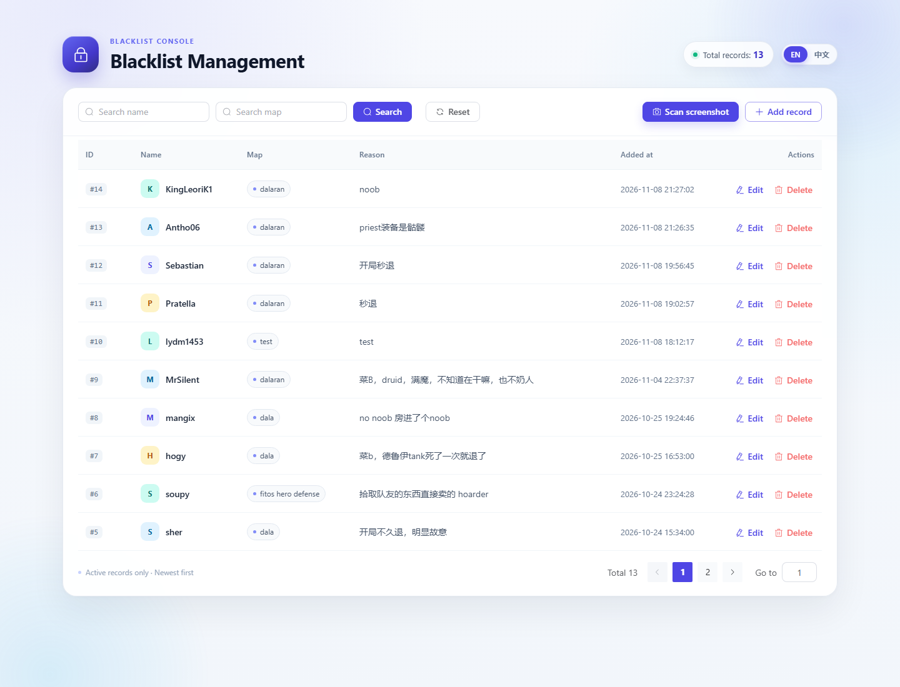
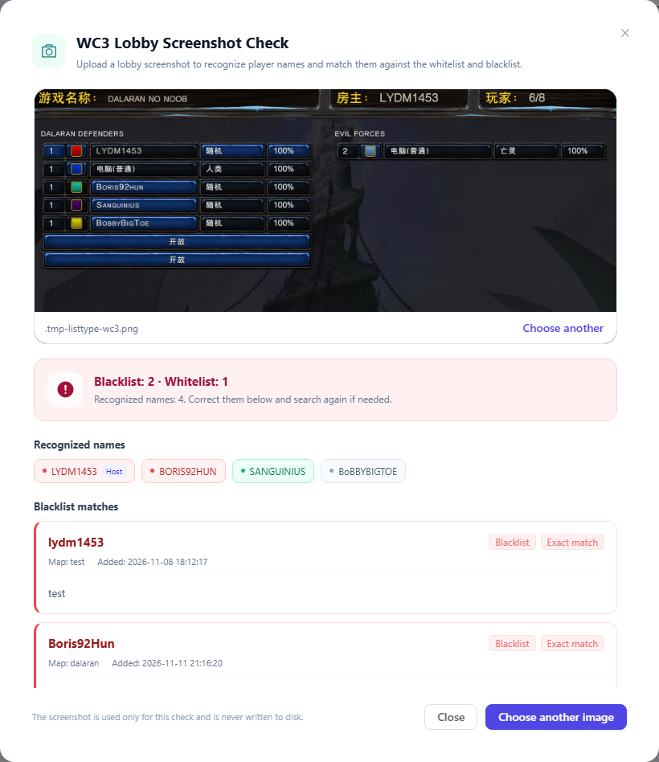
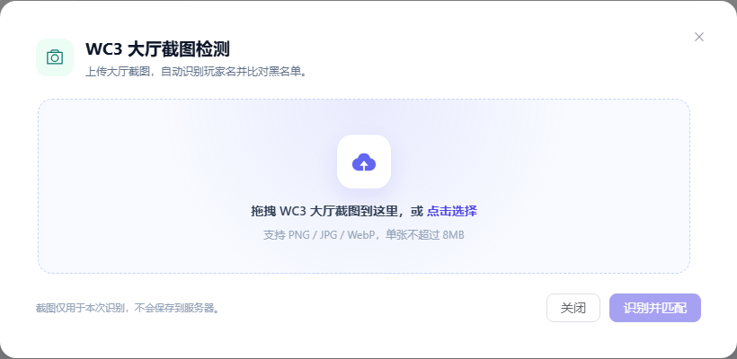

# 名单管理系统

[English](README.en.md) | 简体中文

基于 **Vue 3 + Element Plus + Axios + Koa 2** 的名单管理页面，支持 **黑名单 / 白名单** 两种类型，后端以本地 JSON 文件持久化数据，完整实现搜索、类型筛选、分页、新增、修改与软删除。内置 **WC3 大厅截图检测**：上传截图后自动识别玩家名，并同时匹配白名单和黑名单。



## 功能特性

- 表格仅展示 `isDeleted !== true` 的记录，按 `addTime` 倒序排列
- 支持按名单类型筛选：全部 / 黑名单 / 白名单
- 每页固定 10 条，支持页码切换
- 按 `name` 或 `map` 模糊搜索，OR 关系、大小写不敏感
- 搜索输入 300ms 防抖，空值返回全部
- 新增 / 编辑弹窗可选择名单类型，前后端双重校验
- 黑名单姓名显示为红色、白名单姓名显示为绿色，并提供类型标签
- 删除前二次确认，软删除后记录保留在 JSON 文件中
- 请求统一 `loading`，成功 / 失败均有 Toast 提示
- 自增字符串 ID，删除后不复用；`addTime` 由后端生成
- `async-lock` 串行化读写，避免并发写入丢失数据
- 首次启动自动创建 `data/blacklist.json`，旧记录自动补全为黑名单
- **WC3 大厅截图 OCR**：自动定位双方玩家、识别玩家名，并分别返回白名单 / 黑名单命中原因
- OCR 结果可人工修正后重新匹配；截图只在内存中处理，不落盘
- 前端样式使用 **SCSS**，新增/编辑与截图检测均拆分为独立组件
- 内置 **中文 / English** 国际化，默认英文，右上角可切换并记住选择

## 技术栈

| 端 | 技术 |
| --- | --- |
| 前端 | Vue 3、Vite 5、Element Plus、Axios、SCSS、Vue I18n |
| 后端 | Koa 2、@koa/router、@koa/cors、koa-bodyparser、async-lock |
| 截图识别 | Tesseract.js 5、Sharp、本地英文训练数据 |
| 持久化 | 本地 JSON 文件 `data/blacklist.json` |

## 国际化

页面首次访问默认显示英文，右上角可在 `EN` 与 `中文` 之间切换。

- 使用 `vue-i18n` 管理文案，语言包位于 `src/i18n/locales/`
- Element Plus 组件语言随页面同步切换
- 同时更新 `<html lang>` 和浏览器标签页标题
- 语言选择保存在 `localStorage` 的 `blacklist-locale` 键中
- 如需恢复默认英文，可在浏览器控制台执行：
  ```js
  localStorage.removeItem('blacklist-locale')
  location.reload()
  ```

## 前端组件

| 组件 | 职责 |
| --- | --- |
| `views/BlacklistView.vue` | 名单列表、类型筛选、搜索、分页、删除和页面布局 |
| `components/BlacklistFormDialog.vue` | 添加 / 编辑名单弹窗、类型选择、表单校验和提交 |
| `components/Wc3ScanDialog.vue` | 截图上传、OCR 识别、白/黑名单命中展示和手动修正名单 |

## 目录结构

```text
blacklist/
├─ data/
│  └─ blacklist.json          # 数据文件（首次启动自动创建）
├─ server/
│  ├─ app.js                  # Koa 实例、中间件、统一错误响应
│  ├─ index.js                # 服务入口
│  ├─ blacklistStore.js       # JSON 读写、自增 ID、软删除
│  ├─ routes/
│  │  └─ blacklist.js         # RESTful 路由 + 截图识别接口
│  ├─ services/
│  │  ├─ wc3Scan.js           # 色块定位、图片预处理、OCR、玩家名清洗
│  │  └─ blacklistMatcher.js  # 名称归一化、精确/模糊匹配
│  └─ utils/
│     ├─ errors.js            # HttpError
│     ├─ listTypes.js         # 名单类型常量与兼容处理
│     └─ validation.js        # 参数校验
├─ src/
│  ├─ api/
│  │  ├─ request.js           # Axios 封装、响应拦截器（国际化错误提示）
│  │  └─ blacklist.js         # 黑名单接口
│  ├─ components/
│  │  ├─ BlacklistFormDialog.vue  # 新增 / 编辑弹窗
│  │  └─ Wc3ScanDialog.vue        # WC3 截图检测弹窗
│  ├─ i18n/
│  │  ├─ index.js             # i18n 初始化、语言切换与持久化
│  │  └─ locales/
│  │     ├─ en-US.js          # 英文文案（默认）
│  │     └─ zh-CN.js          # 中文文案
│  ├─ styles/
│  │  ├─ index.scss           # 全局 SCSS
│  │  └─ _dialogs.scss        # 弹窗标题共享 mixin
│  ├─ views/BlacklistView.vue # 列表页面
│  ├─ App.vue
│  └─ main.js
├─ docs/
│  ├─ preview.png
│  ├─ i18n-preview.png
│  ├─ scan-preview.png
│  └─ scan-upload.png
├─ index.html
├─ vite.config.js
├─ package.json
└─ .npmrc
```

## 快速开始

环境要求：Node.js >= 18.17，推荐使用 pnpm 9。

```bash
# 安装依赖
pnpm install

# 同时启动 Koa API（3000）与 Vite 前端（5173）
pnpm dev
```

> 为避免 Windows / Node 20.9 下 `node --watch` 的 FSWatcher 崩溃，服务端默认关闭自动重启。修改后端代码后，重新执行一次 `pnpm dev` 即可。

- 前端页面：<http://127.0.0.1:5173>
- 后端 API：<http://127.0.0.1:3000/api/blacklist>
- 数据文件：`data/blacklist.json`

生产构建与本地预览：

```bash
# 终端 1：启动 API
pnpm start

# 终端 2：构建并预览前端（4173）
pnpm build
pnpm preview
```

> `.npmrc` 中配置了 npmmirror 镜像与 `node-linker=hoisted`，如使用其他镜像可自行调整。
> OCR 训练数据随 `@tesseract.js-data/eng` 一起安装，运行时不需要再访问外网。

### 可选环境变量

| 变量 | 默认值 | 说明 |
| --- | --- | --- |
| `PORT` | `3000` | Koa 服务端口 |
| `VITE_API_BASE_URL` | `/api` | 前端 Axios 的 baseURL |

## WC3 大厅截图检测

点击页面工具栏中的「图片检测」，上传 WC3 大厅截图即可自动识别玩家名，并分别比对白名单和黑名单。



处理流程：

1. Sharp 统一图片格式与尺寸，利用玩家颜色块定位大厅中每一行玩家。
2. 对每个玩家名区域做放大、反色、对比度增强和锐化。
3. Tesseract.js 在本地完成 OCR，自动忽略电脑玩家和 UI 文本。
4. 先精确匹配，再忽略标点/空格匹配，最后进行长度受限的模糊匹配。
5. 结果按白名单 / 黑名单分组展示，并显示命中原因、地图和记录时间。
6. 如 OCR 识别有误，可在弹窗下方逐行修正玩家名并点击「重新匹配」。

限制与说明：

- 支持 PNG / JPG / WebP，单张不超过 8MB
- 首次 OCR 需要初始化识别引擎，通常需 2–5 秒
- 截图仅在服务器内存中处理，不会写入磁盘
- OCR 与模糊匹配都不是 100% 准确，最终处理前建议人工确认
- 当前内置英文 OCR 数据；中文、韩文或纯符号玩家名可能无法正确识别，可在修正名单中手动补充

上传界面：



## 数据字段

| 字段 | 类型 | 必填 | 生成方 | 约束 |
| --- | --- | --- | --- | --- |
| `id` | string | 是 | 后端 | 数字字符串，取全部记录（含已软删）最大 id + 1 |
| `name` | string | 是 | 前端 | 去除首尾空格后长度 1–50 |
| `listType` | string | 是 | 前端 | `black` 表示黑名单，`white` 表示白名单；旧数据默认补为 `black` |
| `map` | string | 是 | 前端 | 去除首尾空格后长度 1–50，手动输入 |
| `reason` | string | 是 | 前端 | 去除首尾空格后长度 1–200 |
| `addTime` | string | 是 | 后端 | `YYYY-MM-DD HH:mm:ss` |
| `isDeleted` | boolean | 是 | 后端 | 默认 `false`，`true` 表示已软删除 |

自增字符串 ID 示例：

```json
[
  { "id": "1", "name": "张伟", "listType": "black", "isDeleted": true },
  { "id": "2", "name": "李娜", "listType": "white", "isDeleted": false }
]
```

此时新增记录得到 `id: "3"`，即使 `id: "1"` 已被软删除也不会复用。

## API

所有接口统一返回：

```json
{
  "code": 0,
  "data": {},
  "msg": "success"
}
```

失败时 `code` 为对应 HTTP 状态码（400 / 404 / 413 / 422 / 500），`data` 为 `null`，`msg` 为错误描述。

| 方法 | 路径 | 说明 |
| --- | --- | --- |
| GET | `/api/blacklist?name=&map=&listType=&page=1&pageSize=10` | 按名称、地图和名单类型筛选 + 分页；`listType` 可为 `black`、`white` 或 `all` |
| POST | `/api/blacklist` | 添加名单，body：`{ name, listType, map, reason }` |
| PUT | `/api/blacklist/:id` | 修改未删除记录，body：`{ name, listType, map, reason }` |
| DELETE | `/api/blacklist/:id` | 软删除，将 `isDeleted` 置为 `true` |
| POST | `/api/blacklist/scan` | 上传 WC3 截图并 OCR 匹配白/黑名单，body：`{ image: "data:image/png;base64,..." }` |
| POST | `/api/blacklist/match` | 对修正后的名称重新匹配，body：`{ names: ["SANGUINIUS"] }` |

### 截图检测响应

```json
{
  "code": 0,
  "data": {
    "names": [
      { "name": "LYDM1453", "confidence": 21, "source": "host" },
      { "name": "SANGUINIUS", "confidence": 39, "source": "player" }
    ],
    "matches": [
      {
        "detectedName": "SANGUINIUS",
        "recognizedText": "SANGUINIUS",
        "matchType": "exact",
        "similarity": 1,
        "record": {
          "id": "9",
          "name": "Sanguinius",
          "listType": "white",
          "map": "dalaran",
          "reason": "可信玩家，无违规记录",
          "addTime": "2026-11-04 22:37:37"
        }
      }
    ],
    "summary": {
      "recognizedCount": 2,
      "matchedCount": 1,
      "blackMatchedCount": 0,
      "whiteMatchedCount": 1
    }
  },
  "msg": "success"
}
```

`matchType` 可能为：

- `exact`：忽略大小写后完全一致
- `normalized`：忽略空格、标点后一致，例如 `solt.....` 与 `solt`
- `fuzzy`：OCR 错字场景的模糊命中，需人工复核

### 查询响应

```json
{
  "code": 0,
  "data": {
    "list": [
      {
        "id": "2",
        "name": "李娜",
        "listType": "white",
        "map": "dal",
        "reason": "可信玩家",
        "addTime": "2026-10-24 15:12:41",
        "isDeleted": false
      }
    ],
    "total": 1,
    "page": 1,
    "pageSize": 10
  },
  "msg": "success"
}
```

### curl 示例

```bash
# 添加白名单
curl -X POST http://127.0.0.1:3000/api/blacklist \
  -H "Content-Type: application/json" \
  -d "{\"name\":\"Alice\",\"listType\":\"white\",\"map\":\"dalaran\",\"reason\":\"trusted\"}"

# 按名称、类型筛选 + 分页
curl "http://127.0.0.1:3000/api/blacklist?name=ali&listType=white&page=1&pageSize=10"

# 修改名单类型
curl -X PUT http://127.0.0.1:3000/api/blacklist/1 \
  -H "Content-Type: application/json" \
  -d "{\"name\":\"Alice\",\"listType\":\"black\",\"map\":\"dalaran\",\"reason\":\"verified violation\"}"

# 软删除
curl -X DELETE http://127.0.0.1:3000/api/blacklist/1
```

## 软删除与校验说明

- 删除只把 `isDeleted` 修改为 `true`，不物理删除记录
- 列表查询、修改、再次删除均会过滤已删除记录
- 重复删除、修改已删除记录、访问不存在的 id 均返回 `404`
- 必填校验失败、长度超限、分页参数非法、名单类型非法均返回 `400`
- 删除后再次新增，ID 仍从历史最大数字 ID 继续递增
- 旧数据没有 `listType` 时，会在首次读取时自动补全为 `black`
