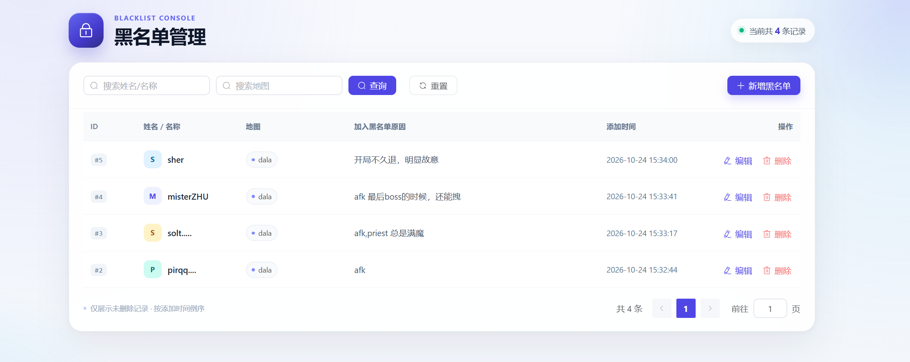

# 黑名单管理系统

基于 **Vue 3 + Element Plus + Axios + Koa 2** 的黑名单管理页面，后端以本地 JSON 文件持久化数据，完整实现搜索、分页、新增、修改与软删除。



## 功能特性

- 表格仅展示 `isDeleted !== true` 的记录，按 `addTime` 倒序排列
- 每页固定 10 条，支持页码切换
- 按 `name` 或 `map` 模糊搜索，OR 关系、大小写不敏感
- 搜索输入 300ms 防抖，空值返回全部
- 新增 / 编辑弹窗表单，前后端双重校验
- 删除前二次确认，软删除后记录保留在 JSON 文件中
- 请求统一 `loading`，成功 / 失败均有 Toast 提示
- 自增字符串 ID，删除后不复用；`addTime` 由后端生成
- `async-lock` 串行化读写，避免并发写入丢失数据
- 首次启动自动创建 `data/blacklist.json`

## 技术栈

| 端 | 技术 |
| --- | --- |
| 前端 | Vue 3、Vite 5、Element Plus、Axios |
| 后端 | Koa 2、@koa/router、@koa/cors、koa-bodyparser、async-lock |
| 持久化 | 本地 JSON 文件 `data/blacklist.json` |

## 目录结构

```text
blacklist/
├─ data/
│  └─ blacklist.json          # 数据文件（首次启动自动创建）
├─ server/
│  ├─ app.js                  # Koa 实例、中间件、统一错误响应
│  ├─ index.js                # 服务入口
│  ├─ blacklistStore.js       # JSON 读写、自增 ID、软删除
│  ├─ routes/
│  │  └─ blacklist.js         # RESTful 路由
│  └─ utils/
│     ├─ errors.js            # HttpError
│     └─ validation.js        # 参数校验
├─ src/
│  ├─ api/
│  │  ├─ request.js           # Axios 封装、响应拦截器
│  │  └─ blacklist.js         # 黑名单接口
│  ├─ styles/index.css        # 全局样式
│  ├─ views/BlacklistView.vue # 页面
│  ├─ App.vue
│  └─ main.js
├─ docs/preview.png
├─ index.html
├─ vite.config.js
├─ package.json
└─ .npmrc
```

## 快速开始

环境要求：Node.js >= 18.11，推荐使用 pnpm 9。

```bash
# 安装依赖
pnpm install

# 同时启动 Koa API（3000）与 Vite 前端（5173）
pnpm dev
```

- 前端页面：<http://127.0.0.1:5173>
- 后端 API：<http://127.0.0.1:3000/api/blacklist>
- 数据文件：`data/blacklist.json`

生产构建与本地预览：

```bash
# 终端 1：启动 API
pnpm start

# 终端 2：构建并预览前端（4173）
pnpm build
pnpm preview
```

> `.npmrc` 中配置了 npmmirror 镜像与 `node-linker=hoisted`，如使用其他镜像可自行调整。

### 可选环境变量

| 变量 | 默认值 | 说明 |
| --- | --- | --- |
| `PORT` | `3000` | Koa 服务端口 |
| `VITE_API_BASE_URL` | `/api` | 前端 Axios 的 baseURL |

## 数据字段

| 字段 | 类型 | 必填 | 生成方 | 约束 |
| --- | --- | --- | --- | --- |
| `id` | string | 是 | 后端 | 数字字符串，取全部记录（含已软删）最大 id + 1 |
| `name` | string | 是 | 前端 | 去除首尾空格后长度 1–50 |
| `map` | string | 是 | 前端 | 去除首尾空格后长度 1–50，手动输入 |
| `reason` | string | 是 | 前端 | 去除首尾空格后长度 1–200 |
| `addTime` | string | 是 | 后端 | `YYYY-MM-DD HH:mm:ss` |
| `isDeleted` | boolean | 是 | 后端 | 默认 `false`，`true` 表示已软删除 |

自增字符串 ID 示例：

```json
[
  { "id": "1", "name": "张伟", "isDeleted": true },
  { "id": "2", "name": "李娜", "isDeleted": false }
]
```

此时新增记录得到 `id: "3"`，即使 `id: "1"` 已被软删除也不会复用。

## API

所有接口统一返回：

```json
{
  "code": 0,
  "data": {},
  "msg": "success"
}
```

失败时 `code` 为对应 HTTP 状态码（400 / 404 / 500），`data` 为 `null`，`msg` 为错误描述。

| 方法 | 路径 | 说明 |
| --- | --- | --- |
| GET | `/api/blacklist?name=&map=&page=1&pageSize=10` | 模糊搜索 + 分页，自动过滤已删除记录 |
| POST | `/api/blacklist` | 新增，body：`{ name, map, reason }` |
| PUT | `/api/blacklist/:id` | 修改未删除记录，body：`{ name, map, reason }` |
| DELETE | `/api/blacklist/:id` | 软删除，将 `isDeleted` 置为 `true` |

### 查询响应

```json
{
  "code": 0,
  "data": {
    "list": [
      {
        "id": "2",
        "name": "niu",
        "map": "dal",
        "reason": "afk。",
        "addTime": "2026-10-24 15:12:41",
        "isDeleted": false
      }
    ],
    "total": 1,
    "page": 1,
    "pageSize": 10
  },
  "msg": "success"
}
```

### curl 示例

```bash
# 新增
curl -X POST http://127.0.0.1:3000/api/blacklist \
  -H "Content-Type: application/json" \
  -d "{\"name\":\"niu\",\"map\":\" /dala\",\"reason\":\"afk\"}"

# 搜索 + 分页
curl "http://127.0.0.1:3000/api/blacklist?name=zhu&page=1&pageSize=10"

# 修改
curl -X PUT http://127.0.0.1:3000/api/blacklist/1 \
  -H "Content-Type: application/json" \
  -d "{\"name\":\"zhu\",\"map\":\" / dala\",\"reason\":\"horder‌\"}"

# 软删除
curl -X DELETE http://127.0.0.1:3000/api/blacklist/1
```

## 软删除与校验说明

- 删除只把 `isDeleted` 修改为 `true`，不物理删除记录
- 列表查询、修改、再次删除均会过滤已删除记录
- 重复删除、修改已删除记录、访问不存在的 id 均返回 `404`
- 必填校验失败、长度超限、分页参数非法均返回 `400`
- 删除后再次新增，ID 仍从历史最大数字 ID 继续递增
